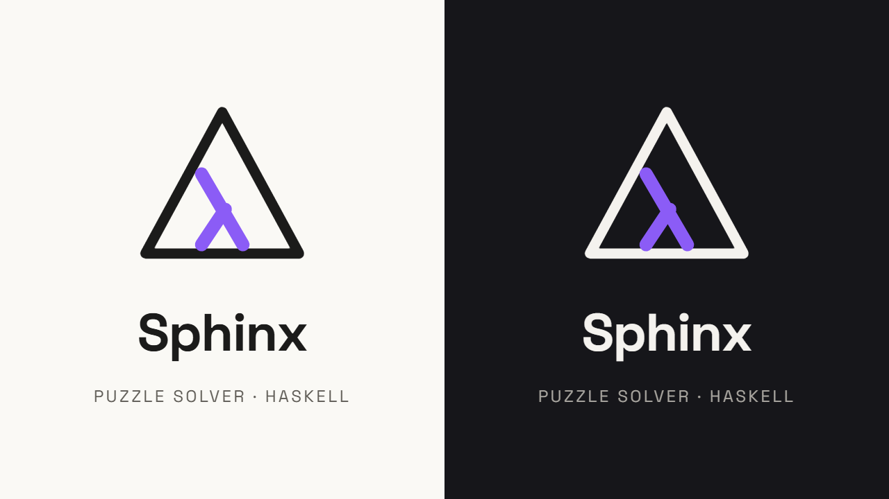

# Sphinx - Penyelesai puzzle dalam Haskell



[](https://github.com/nekonaru/sphinx/actions/workflows/ci.yml)

Sphinx menyelesaikan puzzle berbasis constraint. Ini adalah library
Haskell ditambah CLI yang menangani sudoku dan nonogram, menjelaskan
cara puzzle sudoku diselesaikan langkah demi langkah, dan mengecek
apakah sebuah puzzle punya solusi unik.

Bahasa Indonesia | [English](README.md)

## Fitur

- **Solver sudoku** dengan propagasi constraint (naked single, hidden
  single) dan backtracking dengan heuristik MRV (minimum remaining
  values).
- **Solver nonogram** dengan line solving, propagasi sampai fixpoint,
  lalu backtracking pada baris atau kolom tersulit.
- **Mode langkah demi langkah** (`--steps`) yang mencetak setiap
  deduksi yang dilakukan solver sudoku, dari naked single sampai tebakan.
- **Cek keunikan** (`--count 2`) untuk melihat apakah sebuah puzzle
  punya tepat satu solusi.
- **Generator puzzle** sudoku (`--generate easy|medium|hard`) yang
  menjamin solusi unik.
- **API library** lewat satu typeclass, jadi tipe puzzle baru bisa
  dicolokkan ke antarmuka yang sama.
- Property test (QuickCheck) dan golden test untuk renderer.

## Instalasi

Pasang GHC dan cabal terlebih dahulu (misalnya dengan
[ghcup](https://www.haskell.org/ghcup/)):

```sh
curl --proto '=https' --tlsv1.2 -sSf https://get-ghcup.haskell.org | sh
ghcup install ghc --set recommended
ghcup install cabal --set recommended
```

Lalu build dan pasang Sphinx:

```sh
git clone https://github.com/nekonaru/sphinx.git
cd sphinx
cabal update
cabal install exe:sphinx
```

## Pemakaian

Selesaikan sudoku dan cetak gridnya:

```sh
sphinx sudoku examples/sudoku-easy.txt
```

Cek apakah puzzle itu unik:

```sh
sphinx sudoku examples/sudoku-hard.txt --count 2
```

Cetak langkah-langkah deduksinya:

```sh
sphinx sudoku examples/sudoku-easy.txt --steps
```

Buat puzzle baru:

```sh
sphinx sudoku --generate hard --seed 42
```

Selesaikan nonogram dan tampilkan sebagai gambar blok:

```sh
sphinx nonogram examples/nonogram-heart.txt
```

Semua perintah juga membaca dari standard input bila kamu memberi `-`
sebagai nama file:

```sh
cat examples/sudoku-easy.txt | sphinx sudoku -
```

## Format input

### Sudoku

Satu baris berisi 81 karakter, atau 9 baris berisi 9 karakter. `.` dan
`0` berarti kosong, digit 1-9 adalah angka yang diberikan:

```
530070000600195000098000060800060003400803001700020006060000280000419005000080079
```

### Nonogram

Baris petunjuk baris, baris pemisah `---`, lalu baris petunjuk kolom.
Setiap petunjuk adalah daftar panjang blok yang dipisah spasi; `0` pada
satu baris berarti baris itu kosong:

```
2 2
7
7
5
3
1
---
2
4
5
5
5
4
2
```

## Pemakaian sebagai library

```haskell
import Sphinx.Class (Puzzle(..), firstSolution, isUnique)
import qualified Sphinx.Sudoku.Parse as Sudoku

main :: IO ()
main = case Sudoku.parseSudoku "530070000600195000098000060800060003400803001700020006060000280000419005000080079" of
  Left err -> putStrLn ("puzzle tidak valid: " ++ show err)
  Right grid -> do
    print (firstSolution grid)   -- solusi pertama, bila ada
    print (isUnique grid)        -- True bila tepat satu solusi
```

Typeclass `Puzzle` adalah antarmuka seragam untuk semua tipe puzzle:

```haskell
class Puzzle p where
  type Solution p
  parsePuzzle    :: String -> Either SphinxError p
  solveLimit     :: Int -> p -> [Solution p]
  renderSolution :: p -> Solution p -> String
  renderPuzzle   :: p -> String
```

## Pengembangan

```sh
cabal build           # build library, CLI dan test
cabal test            # jalankan hspec + QuickCheck + golden test
```

Struktur source mengikuti layout standar library + executable: `src/`
berisi library, `app/Main.hs` CLI-nya, `test/` test suite dan
`examples/` contoh puzzle. Cara kerja solver dijelaskan di
`docs/algorithms.md`.

## Performa

Diukur pada GHC 9.6 dengan kode hasil optimasi `-O2` di laptop Windows
sekelas menengah (waktu wall CLI secara end-to-end):

| Puzzle | Waktu |
|--------|-------|
| Sudoku sulit dari generator (`examples/sudoku-hard.txt`, seed 1234) | ~20 ms |
| Nonogram heart (`examples/nonogram-heart.txt`) | ~20 ms |

Solver menghitung sampai N solusi secara lazy, jadi cek keunikan
berhenti di solusi kedua. Nonogram ukuran besar bisa lebih lama bila
propagasi constraint per baris sering harus branch.

## Kontribusi

Issue dan pull request disambut. Jalankan `cabal test` sebelum mengirim;
CI menegakkan build bebas warning.

## Lisensi

[MIT](LICENSE) (c) 2026 nekonaru
