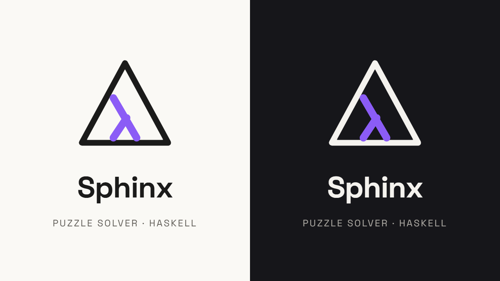

<div align="center">
  
  <h1>Sphinx: Puzzle Solver</h1>
  <p><b>Constraint-based puzzle solver: sudoku and nonogram, solved fast,<br/>
  explained step by step. A CLI and a reusable library.</b></p>

  <a href="https://github.com/nekonaru/sphinx/releases"></a>
  <a href="https://github.com/nekonaru/sphinx/actions/workflows/ci.yml"></a>
  
  
  
  
</div>

<br />

**English** | [Bahasa Indonesia](README.id.md)

> [!NOTE]
> Sphinx is a puzzle solver for sudoku and nonogram puzzles. It reads a text file, prints the answer, explains how it got there, and checks whether a puzzle is uniquely solvable.

---

## Table of Contents

- [About](#about)
- [Features](#features)
- [Requirements](#requirements)
- [Installation](#installation)
- [Usage](#usage)
- [Project Structure](#project-structure)
- [Development](#development)
- [Testing](#testing)
- [Security](#security)
- [Continuous Integration](#continuous-integration)
- [FAQ](#faq)
- [Author](#author)
- [License](#license)

---

## About

**Sphinx** is an open source puzzle solver written in Haskell. It handles sudoku and nonogram puzzles, explains how it solved a sudoku step by step, checks whether a puzzle has a unique solution, and can generate fresh sudoku puzzles with a guaranteed unique solution. Use it as a command line tool or as a library behind the `Puzzle` typeclass.

---

## Features

### Solvers

| Feature | Description |
|---------|-------------|
| **Sudoku solver** | Constraint propagation (naked singles, hidden singles) followed by backtracking with a minimum remaining values heuristic |
| **Nonogram solver** | Line solving, constraint propagation to a fixpoint, then branching on the line with the fewest remaining options |
| **Step-by-step mode** | `--steps` prints every deduction the solver made, classified as `NakedSingle`, `HiddenSingle` or `Guess` (Bahasa Indonesia) |
| **Solution counting** | `--count N` counts up to N solutions; `--count 2` tells you whether a puzzle is unique |
| **Puzzle generator** | `--generate easy\|medium\|hard` creates a new sudoku with a guaranteed unique solution (`--seed` for reproducible puzzles) |
| **Nonogram rendering** | Solved nonograms print as a block image with aligned row and column clues |

### Library

| Feature | Description |
|---------|-------------|
| **`Puzzle` typeclass** | One uniform interface: `parsePuzzle`, `solveLimit`, `renderSolution`, `renderPuzzle` |
| **Pure core** | All solving logic is lazy, pure and side-effect free; I/O lives only in the CLI |
| **Typed errors** | Every failure mode has a typed error with a friendly message |

### Examples and Testing

| Feature | Description |
|---------|-------------|
| **Sample puzzles** | `examples/` ships an easy sudoku, a hard sudoku, a multi-solution sudoku and two nonograms |
| **Property tests** | QuickCheck properties for solver correctness, plus hostile-input fuzzing for both parsers |
| **Golden tests** | Renderer output is verified against committed golden files |

---

## Requirements

| Dependency | Minimum Version | Notes |
|------------|-----------------|-------|
| **GHC** | 9.6.6 | Install via [ghcup](https://www.haskell.org/ghcup/) |
| **cabal-install** | 3.10+ | Install via ghcup as well |
| **Hackage index** | latest | `cabal update` downloads it once |
| **C compiler** | any bundled with ghcup | Only needed if a dependency compiles C code (none of the current ones do) |

> [!TIP]
> If you only want the CLI and do not plan to build from source, the build section below is still two commands: `cabal update` and `cabal install exe:sphinx`.

---

## Installation

### Option A: Build and install the CLI

1. Install the toolchain (skip if you already have ghcup):

```bash
curl --proto '=https' --tlsv1.2 -sSf https://get-ghcup.haskell.org | sh
ghcup install ghc --set recommended
ghcup install cabal --set recommended
```

2. Get the code and install the executable:

```bash
git clone https://github.com/nekonaru/sphinx.git
cd sphinx
cabal update
cabal install exe:sphinx
```

3. Verify the installation:

```bash
sphinx --version
sphinx --help
```

### Option B: Build from source for development

Same as Option A, plus the test suite:

```bash
cabal build --ghc-options=-Werror
cabal test --test-show-details=direct
```

> [!IMPORTANT]
> A clean build means zero warnings. If `cabal build` prints any `-W` warnings, the change is not ready.

---

## Usage

### First launch

Solve the included example puzzle and print the grid:

```bash
sphinx sudoku examples/sudoku-easy.txt
```

Check that it really solved it:

```bash
sphinx sudoku examples/sudoku-hard.txt --count 2
```

### Everyday use

- **Solve with explanation**: `sphinx sudoku examples/sudoku-easy.txt --steps`
- **Check uniqueness**: `sphinx sudoku examples/sudoku-hard.txt --count 2`
- **Generate a puzzle**: `sphinx sudoku --generate hard --seed 42`
- **Solve a nonogram**: `sphinx nonogram examples/nonogram-heart.txt`
- **Nonogram uniqueness**: `sphinx nonogram examples/nonogram-heart.txt --count 2`
- **Search statistics**: `sphinx nonogram examples/nonogram-heart.txt --steps`
- **From a pipe**: `cat examples/sudoku-easy.txt | sphinx sudoku -`

### Input formats

Sudoku: one line of 81 characters, or 9 lines of 9 characters. `.` and `0` mean empty, digits 1-9 are givens.

```
530070000600195000098000060800060003400803001700020006060000280000419005000080079
```

Nonogram: row clue lines, a separator line with `---`, then column clue lines. Each clue is a space separated list of block lengths; `0` on a line means that line is empty.

```
2 2
7
7
5
3
1
---
2
4
5
5
5
4
2
```

### Library usage

```haskell
import Sphinx.Class (Puzzle(..), firstSolution, isUnique)
import qualified Sphinx.Sudoku.Parse as Sudoku

main :: IO ()
main = case Sudoku.parseSudoku "530070000600195000098000060800060003400803001700020006060000280000419005000080079" of
  Left err -> putStrLn ("invalid puzzle: " ++ show err)
  Right grid -> do
    print (firstSolution grid)   -- first solution, if any
    print (isUnique grid)        -- True when exactly one solution exists
```

The `Puzzle` typeclass is the single extension point for new puzzle types:

```haskell
class Puzzle p where
  type Solution p
  parsePuzzle    :: String -> Either SphinxError p
  solveLimit     :: Int -> p -> [Solution p]
  renderSolution :: p -> Solution p -> String
  renderPuzzle   :: p -> String
```

---

## Project Structure

```
sphinx/
├── sphinx.cabal                 # Package definition (library, CLI, test suite)
├── app/
│   └── Main.hs                  # CLI entry point (optparse-applicative)
├── src/
│   ├── Sphinx/
│   │   ├── Class.hs             # Puzzle typeclass and helpers
│   │   ├── Error.hs             # Typed errors for every failure mode
│   │   ├── Sudoku/              # Types, Parse, Solve, Render, Generate, Puzzle
│   │   └── Nonogram/            # Types, Parse, Line, Solve, Render, Puzzle
├── test/
│   ├── Spec.hs                  # hspec + QuickCheck + golden tests
│   └── golden/                  # Expected renderer output
├── examples/                    # Sample puzzles (sudoku, nonogram)
├── docs/
│   └── algorithms.md            # How the solvers work
├── assets/
│   └── logo.png
├── README.md                    # English (this file)
├── README.id.md                 # Bahasa Indonesia
└── LICENSE                      # MIT
```

---

## Development

### Adding a feature

1. Write or adjust the tests first (hspec for examples, QuickCheck for properties).
2. Keep the library pure; all I/O stays in `app/Main.hs`.
3. Build with warnings as errors: `cabal build --ghc-options=-Werror`.
4. Run the full suite: `cabal test`.
5. Update `README.md` and `README.id.md` together, and add a line to both changelogs.

> [!WARNING]
> `test/golden/` files are expected outputs. Update them only by rerunning the renderer, never by editing them by hand.

### Adding a new puzzle type

1. Create `src/Sphinx/<YourPuzzle>/` with `Types`, `Parse`, `Solve`, `Render`, `Puzzle` modules, mirroring the sudoku and nonogram layouts.
2. Add an instance of the `Puzzle` typeclass (see `src/Sphinx/Sudoku/Puzzle.hs`).
3. Wire it into the CLI in `app/Main.hs` and add tests plus examples.

---

## Testing

```bash
cabal build --ghc-options=-Werror
cabal test --test-show-details=direct
```

| Check | Requirement |
|-------|-------------|
| Build | Zero warnings, zero errors (`-Werror`) |
| Unit tests | All examples pass |
| Property tests | QuickCheck properties pass (solver correctness, input fuzzing) |
| Golden tests | Renderer output matches `test/golden/` exactly |

The suite has 34 examples and runs in about a second.

---

## Security

Sphinx is an offline tool: it reads text files you point it at and prints results. It does not use the network, does not run subprocesses, does not store credentials, and does not create temporary files. The CLI rejects files larger than 1 MiB, and both parsers return typed errors for malformed input. Dependencies are built with `-Werror` in CI on three GHC versions.

> [!NOTE]
> Report vulnerabilities privately via GitHub Security Advisories: https://github.com/nekonaru/sphinx/security/advisories/new. See [SECURITY.md](SECURITY.md).

---

## Continuous Integration

| Workflow | Purpose |
|----------|---------|
| `ci.yml` | Build with `-Werror` and run the full test suite on GHC 9.6.6, 9.8.4 and 9.10.1 |

Branch `main` requires the `build-test` checks to pass before merges; direct pushes by the maintainer are allowed. Releases are tagged `vX.Y.Z` after CI is green.

---

## FAQ

<details><summary><b>Does it need internet?</b></summary>

No. Sphinx works fully offline. Only `cabal update` on first install downloads package metadata.

</details>

<details><summary><b>Why Haskell?</b></summary>

Pure functions, immutable data and laziness fit backtracking solvers: the solver count (`--count`) stops as soon as it knows the answer.

</details>

<details><summary><b>Can I use it as a library?</b></summary>

Yes. Add the `sphinx` package as a dependency and use the `Puzzle` typeclass. See [Library usage](#library-usage).

</details>

<details><summary><b>How accurate is the generated puzzle difficulty?</b></summary>

Difficulty is defined by how many givens remain (easy 40, medium 32, hard 26). Hard is not the same as every human-rated hardest puzzle, but every generated puzzle has exactly one solution.

</details>

<details><summary><b>Is the output of <code>--steps</code> in English?</b></summary>

No. `--steps` prints deduction steps in Bahasa Indonesia, as specified in the product requirements. Everything else is in English.

</details>

---

## Author

<div align="center">

| [](https://github.com/nekonaru) |
|:---:|
| **nekonaru** ([GitHub](https://github.com/nekonaru)) |

</div>

---

## License

Distributed under the **MIT License**. See [`LICENSE`](LICENSE) for more information.
